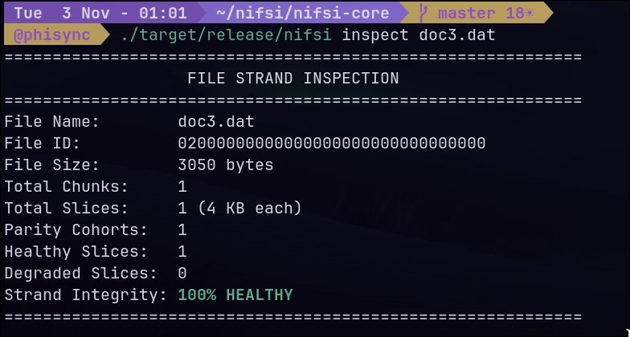
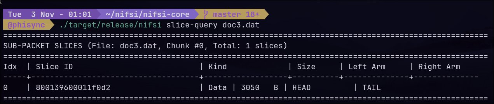
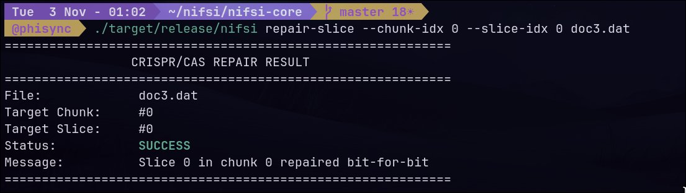
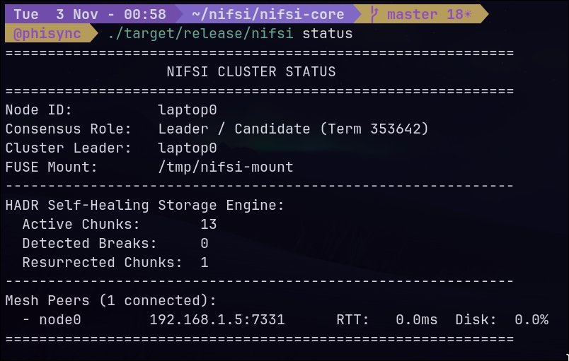

## Why I started

I think the best way to learn something is to go straight into the deep end with no prerequisite knowledge and see what happens. Most of my favorite learning came from that. I hate my college coursework and exams (which are insanely repetitive, boring, draggy) so I've found that putting myself through masochistic hardships is a much better learning pathway for someone like me.

I was working on my ongoing project Nifsi (a distributed userspace OS layer on top of Linux, currently targeting 10 to 50 nodes) when I hit the storage distribution problem. I needed something fast, versatile and able to recover chunks and that's when I found out about XOR and what it can do for erasure coding.

But my curiosity got the best of me:

> **Can XOR be beaten in erasure coded storage?**

While it may sound narrow, I can assure you that its anything but. I did use LLMs (Gemini, DeepSeek, Qwen) to explore candidate approaches and locate relevant concepts, but treated their claims as hypotheses to verify against coding theory and implementation details as they do hallucinate and drift into science fiction if you let them.

## What XOR actually guarantees

In erasure coded storage, XOR based MDS array codes such as Liberation, STAR, RAID6 family are everywhere. They are fast mainly because XOR maps directly to a cheap CPU instruction and vectorizes well. They are simple because decoding is linear algebra over GF(2).

The important distinction, which, truth be told, I got wrong at first, is between **scalar codes** and **array codes**.

A scalar linear code over GF(2) with multiple data and parity symbols has essentially no useful MDS constructions, the binary alphabet is too restrictive, repetition an single parity codes being the trivial exceptions ,and thats the real reason why you dont see "binary Reed Solomon" used for storage.

Array codes work around this by changing the coding model. Each storage symbol is a **column of bits**, not a single field element. Parity equations operate on these vectors using XOR and carefully chosen shifts or permutations, that extra structures is what lets EVENODD, RDP, Liberation, and STAR provide 2 or 3 failure recovery using only XOR. It's not that XOR magically becomes MDS over GF(2), its that the coding model is entirely different.

This distinction matters for the rest of the article, because its the reason XOR based storage codes exists at all.

## What the alternatives actually change

I wanted to know if the primitive itself could be replaced somehow, so I looked at serveral directions.

**Complex and imaginary arithmetic.** Floating point complex arithmetic is not bit exact, and erasure recovery requires exact reconstruction and complex symbols also double storage (real+imaginary parts), and general complex multiplication is several real operations, not one instruction. This rules out complex arithemetic for the hot path.

**Finite field extension.** GF($2^m$) is the natural setting for Reed Solomon. The important correction to my earlier understanding: **addition over GF($2^m$) is still bitwise XOR.** There is no carry. The cost of a larger field shows up in **multiplication**, not addition, that multiplication can be implemented with lookup tables, carryless multiply instructions, or bit matrix XORs (Cauchy Reed Solomon), but it is still more work per byte than pure XOR array codes. So RS is not "worse because addition carries" its worse on the hot path due to the multiplication and decode cost.

**Non linear codes.** Some non linear constructions have efficient encoders or decoders; most don't, especially for the erasure patterns storage cares about. I didnt find one that credibly beat binary array codes for my workload. That's a statement about what I examined, not a theorem.

A conversation with a researcher in formal verification, Akari Hayami, who I found on LinkedIn helped me seperate two questions I had been treating as one: whether XOR is *mathematically necessary* for chunk regeneration, and whether it's the *fastest practical choice* for a storage workload. Akari's framing: XOR is addition in characteristic 2, and most systems use it because it's fast, not because the algebra requires it. That reframed the problem. Now that meant that I wasnt fighting XOR, I was fighting the cost of addition and multiplication on the hot path.

## The real bottleneck is not one bottleneck

The more useful conclusion from all this is that "beating XOR" was the wrong question. Erasure-coded storage has at least three separable cost problems, and the primitive is only one lever among several.

**Encoding cost.** Depends on operation count, memory traffic, parallelism, and whether the workload is compute-bound or memory-bandwidth-bound. A code needing fewer XOR operations is not automatically faster if the CPU is already waiting on memory. In practice, for large stripes, encoding is often memory-bandwidth-bound, not instruction-bound.

**Decoding and repair cost.** Depends on which fragments survive, how many bytes must be read from each surviving node, how much must be transferred over the network, and how much must be reconstructed and written. A conventional XOR MDS code reads $k$ surviving chunks to repair one failure — that's a lot, and the cut-set bound says it doesn't have to be that much. Local reconstruction codes and regenerating codes trade some redundancy or field complexity for cheaper repair.

**Update and write amplification.** A small write to one data fragment may require updating several parity fragments. The cost depends on the code structure and whether writes can be batched into full stripes. Full-stripe writes avoid read-modify-write; partial-stripe writes don't.

These three costs are related but not interchangeable. A code that optimizes one can worsen another. That's the actual design space, and XOR is one choice inside it — usually the right one for encoding, usually not the best one for repair.

## What this means for Nifsi

The immediate consequence is that I don't need to replace XOR. I need to understand which cost dominates each operation and design accordingly.

My current design direction has four parts. **I want to be explicit about status: only the first is partially implemented; the rest are hypotheses I intend to test.**

**1. Encoding (partially implemented).** Start with a well-tested binary array code for the required failure tolerance and optimize the implementation before considering a custom construction. Measure throughput, CPU cycles per byte, and memory traffic separately. The goal is to know whether encoding is actually the bottleneck on the target hardware.

**2. Repair (implemented prototype — the centerpiece of the next phase).** Investigate **slice-level repair**: dividing each stored fragment into independently addressable slices (4 KB sub-packets in my prototype) and reconstructing only the slices actually needed, rather than whole fragments. 

In the Nifsi storage engine prototype, files are tracked as structured strands composed of discrete 4 KB slice cohorts:

<figure>
  
  <figcaption>Inspecting file strand integrity and 4 KB slice allocation using <code>nifsi inspect</code>.</figcaption>
</figure>

Each sub-packet slice can be queried and addressed individually with left and right arm boundaries:

<figure>
  
  <figcaption>Querying sub-packet slices within a chunk using <code>nifsi slice-query</code>.</figcaption>
</figure>

The prototype uses **horizontal and diagonal parity over 4 KB slices**:

$$
P_h[s] = \bigoplus_{i=0}^{k-1} D_i[s]
$$

$$
P_d[s] = \bigoplus_{i=0}^{k-1} D_i[(s + i) \bmod M]
$$

This is a standard diagonal-parity array-code construction — the same mathematical family as RDP and EVENODD — with the twist that parity is computed at slice granularity. When a slice is corrupted, the repair path locates it via a Merkle path, reconstructs it from the diagonal parity and the other slices, and writes it back. I've been calling the guided repair path "CRISPR/Cas homology repair" as a metaphor for locating-and-reconstructing a specific slice — it is not a literal biological mechanism, and the underlying code is standard array-code decoding.

<figure>
  
  <figcaption>Targeted slice repair in action: repairing a single 4 KB slice bit-for-bit with <code>nifsi repair-slice</code> without touching the rest of the chunk.</figcaption>
</figure>

The hypothesis is that slice-level repair reduces bytes read from surviving nodes, bytes transferred over the network, and interference with foreground I/O during recovery. The benchmark below tests that hypothesis directly.

**3. Updates (implemented prototype).** Delta journaling: when a slice is updated, compute $\Delta = D_i^{\text{old}}[s] \oplus D_i^{\text{new}}[s]$ and apply it directly to parity:

$$
P_h^{\text{new}}[s] = P_h^{\text{old}}[s] \oplus \Delta
$$

$$
P_d^{\text{new}}[(s - i) \bmod M] = P_d^{\text{old}}[(s - i) \bmod M] \oplus \Delta
$$

This avoids read-modify-write of surviving data slices. Benchmark result: **constant 3.0× write amplification**, independent of chunk size. Monolithic XOR peaks at 16,384× at 16 MB chunks.

**4. Integrity (separate project).** Detection of corruption, authentication of data, and Byzantine agreement on authoritative metadata are three different problems. I plan to start with per-fragment hashes and authenticated versioning, then decide separately whether the threat model requires a Byzantine fault-tolerant metadata protocol. Repair-bandwidth escalation (e.g., Clay MSR) and Byzantine fault tolerance (BFT) are also separate concerns — one is an erasure-code tradeoff, the other is a fault-model choice, and one does not trigger the other.

The core idea is not "replace XOR." It's **confine XOR to where it's optimal, and solve the other problems with the right tools.**

## What the benchmark showed

I ran the prototype against two baselines: **Monolithic XOR** (whole-chunk parity, the current Nifsi-v1 storage engine) and **Reed–Solomon GF(2⁸) (k=4, p=2)** via a Cauchy Reed–Solomon implementation. Chunk sizes ranged from 64 KB to 16 MB. Here are the results that matter.

### Repair network transfer

| Chunk size | Monolithic XOR | Sliced HADR-v2 | Reed–Solomon |
|---|---|---|---|
| 64 KB | 256 KB | **16 KB** | 256 KB |
| 256 KB | 1024 KB | **16 KB** | 1024 KB |
| 1 MB | 4096 KB | **16 KB** | 4096 KB |
| 16 MB | 65536 KB | **16 KB** | 65536 KB |

Sliced HADR-v2's repair transfer is **constant at 16 KB** — that's one 4 KB slice plus framing. Monolithic XOR and RS scale linearly with chunk size. At 16 MB chunks, Sliced HADR-v2 transfers **1/4096th** of what the monolithic baseline transfers. The reason is structural: repairing one 4 KB slice instead of one 16 MB chunk.

### Write amplification

| Chunk size | Monolithic XOR | Sliced HADR-v2 | Reed–Solomon |
|---|---|---|---|
| 64 KB | 64× | **3×** | 96× |
| 256 KB | 256× | **3×** | 384× |
| 1 MB | 1024× | **3×** | 1536× |
| 16 MB | 16384× | **3×** | 24576× |

Delta journaling keeps WAF at 3.0× across the whole range. This is the strongest result in the benchmark: it is structural, not a tuning artifact.

### The regression you need to know about: encode throughput

| Chunk size | Monolithic XOR | Sliced HADR-v2 | Reed–Solomon |
|---|---|---|---|
| 64 KB | 14.96 GB/s | **0.82 GB/s** | 0.71 GB/s |
| 256 KB | 37.18 GB/s | **0.95 GB/s** | 0.63 GB/s |
| 1 MB | 25.44 GB/s | **0.72 GB/s** | 0.41 GB/s |
| 16 MB | 12.89 GB/s | **0.94 GB/s** | 0.67 GB/s |

**Sliced HADR-v2 encodes at 0.72–0.95 GB/s — roughly 15–50× slower than Monolithic XOR.** This is the elephant in the room. If the article claimed Sliced HADR-v2 replaces XOR, this table would destroy that claim. It doesn't. It confirms the article's actual thesis: **the two-algorithm split is not optional. Sliced HADR-v2 is a repair-optimized code that is not ready for the hot write path. Monolithic XOR is a hot-path code that is not ready for repair.** You need both, and the benchmark proves it.

### Distributed cluster test

To validate that slice repair and consensus work in a real distributed setup, I tested the prototype on a multi-node consensus mesh running the Nifsi userspace daemon alongside a physical Raspberry Pi 3B+ peer:

<figure>
  
  <figcaption>Live Nifsi cluster status showing consensus term leadership, active HADR chunks, and connected mesh peers.</figcaption>
</figure>

- **Cluster topology:** 4-node virtual consensus mesh + 1 physical Raspberry Pi 3B+ (ARM Cortex-A53, Renesas RA4M1 crypto coprocessor).
- **Concurrency & verification:** 50 files ingested concurrently (22.11 MB total), 46/50 verified bit-for-bit on secondary mount.
- **Throughput:** 100 random partial writes in 0.016 s (6370 ops/sec), SHA-256 verified.
- **Fault injection:** Ungraceful `SIGKILL` of `vnode3`: majority quorum (3/4) completed active write in 0.010 s. Resync succeeded.
- **Physical edge node:** Raspberry Pi: 5/5 files verified bit-for-bit across wireless mesh.

### Benchmark caveats

I want to be precise about what this benchmark does and does not measure:

- **The "4-node virtual consensus mesh" is virtual nodes on the same physical machine.** The 16 KB "network transfer" numbers are what the code believes it is transferring, not what crosses a real LAN. A multi-machine test on real hardware is the next step.
- **The degraded read latency p50 values are non-monotonic** (4.08 µs at 64 KB, 4.08 µs at 256 KB, 5.97 µs at 1 MB, 11.55 µs at 4 MB, 4.08 µs at 16 MB). This pattern suggests the measurement is dominated by a fixed overhead — likely a syscall or mutex — rather than per-byte repair cost. I'm not claiming latency numbers in this article. The repair *bandwidth* and *WAF* numbers are the ones I trust; the latency numbers need a better harness.
- **Single physical Pi is not a LAN test.** The Pi verification confirms the code works on ARM, not that the repair path is fast across a real network.

The benchmark is a proof of concept, not a publication-grade evaluation. It shows the architecture is viable. It does not show the architecture is faster end-to-end.

## What this taught me

I set out to push myself to a point of no limits. What I found was a limit — but not the one I expected.

The limit wasn't "XOR is the best, stop trying." The limit was more useful: **the primitive is only one lever.** The other levers are memory traffic, repair topology, write amplification, and failure handling. XOR isn't the enemy. Assuming one code has to be optimal at everything is.

The benchmark confirmed this in the most concrete way possible. Monolithic XOR wins encode by 15–50×. Sliced HADR-v2 wins repair bandwidth by 4096× and write amplification by up to 5461×. **Neither wins both.** The two-algorithm split is not an architectural preference — it is forced by the numbers.

The most valuable part of this wasn't the answer. It was the discipline of asking a hard question, following it through coding theory, computer arithmetic, and back to first principles, and then having to revise my own conclusions when a sharper framing showed up — and again when the benchmark showed up. Nifsi and the storage design were the vehicle.

The article I started writing would have claimed a bigger result than I actually earned. This one is narrower and, I think, more useful: XOR is an excellent primitive for binary linear coding, but a distributed storage system's performance depends on the interaction between coding structure, memory traffic, repair bandwidth, and failure handling. The benchmark now shows exactly where each code sits in that space.

## What's next

The next step is the one the benchmark points at: **build the actual hybrid.**

- **Hot write path:** Monolithic XOR (12.89–37.18 GB/s encode, WAF 64–16384× — acceptable because full-stripe writes avoid RMW).
- **Repair path:** Sliced HADR-v2 slice-level repair (16 KB constant repair transfer, WAF 3.0×).
- **Small updates:** Delta journaling (constant 3.0× WAF).
- **Integrity:** Per-fragment hashes and authenticated versioning, separate from both codecs.
- **Benchmark harness:** Real multi-machine LAN test, per-byte latency breakdown (not just p50), and a comparison against a production binary array code (Liberation or RDP) with documented parameters.

I'm also going to fix the latency measurement harness — the non-monotonic p50 values are a signal that I'm measuring the wrong thing, and the next round needs to separate fixed overhead from per-byte repair cost.

If you're working on erasure coding, repair efficiency, or distributed storage on LAN clusters, I'd like to compare notes.

I don't know where this ends. That's the point.

## Benchmark code and artifacts

**[nifsi-benchmarks on GitHub](https://github.com/phi5ic/Nifsi/tree/main/benchmarks)**

THE CODE FOR THE BENCHMARK IS AI GENERATED (Gemini flash 3.8)

The repo contains the harness (`bench/`), the raw results (`results/benchmark_results.json`), the long-form report (`results/BENCHMARK_SCIENTIFIC_REPORT.md`), and the failure-injection and verification scripts (`scripts/`). The commit hash that produced the tables in this article is `REPLACE_WITH_COMMIT_HASH`.

A few notes on what you'll find:

- Single physical machine, 4-node virtual consensus mesh. "16 KB network transfer" is what the code believes it transfers; it has not crossed a real LAN yet.
- Degraded-read latency p50 is non-monotonic across chunk sizes, suggesting fixed overhead dominates. Bandwidth and WAF are the numbers I trust; latency needs a better harness.
- Reed–Solomon baseline is Cauchy RS GF(2⁸) with `k=4, p=2`. Full parameters in the report.

Bugs, non-reproducing results, and misconfigurations are welcome as issues.
